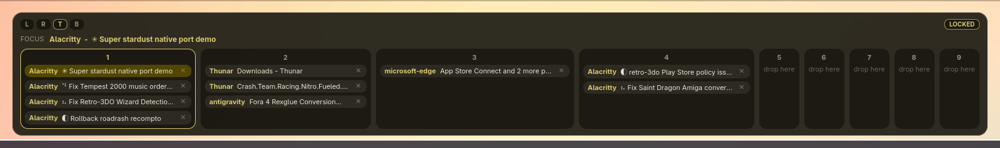

# hypr-windows

An on-screen window map and dock for **Hyprland 0.57**, plus the bar button
that opens it.

Every open window, grouped by the workspace it sits on. Click a window to go
to it, drag it onto another workspace to move it, press its **✕** to close it,
and the top line always names the window that currently has focus.

It docks to any edge, either locked open — reserving its strip so tiled
windows sit beside it — or popping in when the pointer touches the edge.


## Screenshots

Docked along the top instead, with the workspaces running across:



The bar button it replaces four workspace buttons with — click to open the
dock, scroll to change workspace:


## Why

Hyprland hides a lot of state: windows parked on another workspace, windows in
a special workspace (the usual "show desktop" minimise), and nothing on screen
says what has focus. This puts all of it in one place you can act on.

## Requirements

- **Hyprland 0.57 or newer.** It drives the compositor through the Lua
  dispatcher API that 0.57 introduced, so it will not work on 0.4x.
- `gtk4`, `gtk4-layer-shell`, `python-gobject`, and Python 3.9+.

```sh
# Arch
sudo pacman -S gtk4 gtk4-layer-shell python-gobject

# Fedora
sudo dnf install gtk4 gtk4-layer-shell python3-gobject

# Debian/Ubuntu (gtk4-layer-shell may need a backport or a build)
sudo apt install libgtk-4-1 libgtk4-layer-shell0 python3-gi
```

## Install

```sh
git clone https://github.com/CrownParkComputing/hypr-windows
cd hypr-windows
./install.sh            # symlinks bin/* into ~/.local/bin
hypr-windows            # start it (run again to toggle)
```

To start it with your session, use a systemd user unit:

```ini
# ~/.config/systemd/user/hypr-windows.service
[Unit]
Description=hypr-windows dock
PartOf=graphical-session.target
After=graphical-session.target

[Service]
ExecStart=%h/.local/bin/hypr-windows --no-toggle
Restart=on-failure

[Install]
WantedBy=graphical-session.target
```

```sh
systemctl --user enable --now hypr-windows
```

**Do not launch it straight from `hl.on("hyprland.start", ...)`.** That
handler runs about 0.1s into the compositor's boot, but
`$XDG_RUNTIME_DIR/wayland-N` only appears around 3s in, so every Wayland
client started there dies instantly with "cannot connect to display" — which
looks random, because non-Wayland commands in the same handler survive. If you
want it in the config anyway, wait for the socket first:

```lua
hl.on("hyprland.start", function()
    hl.dispatch(hl.dsp.exec_cmd(
        "bash -c 'until [ -S \"$XDG_RUNTIME_DIR/$WAYLAND_DISPLAY\" ]; "
        .. "do sleep 0.2; done; exec hypr-windows --no-toggle'"))
end)
```

To put it on the bar in place of waybar's workspace buttons, see
[`waybar/README.md`](waybar/README.md).

## Using it

| Action | What it does |
| --- | --- |
| Click a window chip | Switches to that window's workspace **and** focuses it |
| Drag a chip onto a workspace | Moves that window there |
| Click a chip's ✕ | Closes that window |
| `L` `R` `T` `B` | Moves the dock to that edge |
| `LOCKED` / `POP-IN` | Locks the dock open, or lets it slide away |

Settings live in `~/.config/hypr-windows/config.json` and are written whenever
you change them from the dock:

```json
{
  "position": "left",      // left | right | top | bottom
  "locked": true,          // true: a dock that reserves its strip
                           // false: slides off the edge, pops in on touch
  "width": 300,            // thickness of a left/right dock
  "hide_delay_ms": 600,    // grace period before it slides away again
  "trigger_px": 4          // sliver left on screen to touch when slid out
}
```

Flags override the stored settings for one run; add `--save` to keep them:

```sh
hypr-windows --right --save      # dock on the right from now on
hypr-windows --pop-in            # just this once, slide away when unused
hypr-windows --width 360 --save
```

`SIGUSR1` slides a pop-in dock in or out, so a keybind can reach it:

```lua
hl.bind("SUPER + W", hl.dsp.exec_cmd("pkill -USR1 -f hypr-windows"))
```

Running `hypr-windows` again quits a locked dock, and slides a pop-in one
in or out — so one bar button or keybind does the right thing in both modes.

## Notes for anyone hacking on it

Three things here cost real time to find:

- **Hyprland 0.57's dispatchers are Lua, and only honour a window *object*.**
  `hyprctl dispatch "movetoworkspace 1,address:0x..."` is parsed as Lua and
  dies; worse, `hl.dsp.window.close("address:0x...")` returns `ok` and closes
  **whatever has focus**. Every action here loops over `hl.get_windows()` and
  matches `w.address`, then passes the object: `hl.dsp.window.move({ workspace
  = 1, window = w })`. Targeting by object was checked for close by killing an
  unfocused throwaway while a second throwaway held focus — the right one died.
- **gtk4-layer-shell must be loaded before libwayland-client**, which a script
  cannot arrange at link time. Without it the window silently comes up as an
  ordinary toplevel. `hypr-windows` re-execs itself once with
  `LD_PRELOAD=/usr/lib/libgtk4-layer-shell.so`; the `liblayer-shell-preload.so`
  in the same package does *not* fix it.
- **A hair-thin trigger window would not map** beside a hidden dock, and an
  unmapped dock cannot catch a pointer. Pop-in therefore keeps one surface
  mapped and slides it off the edge with a negative margin, leaving a few
  pixels to touch.

The dock sets `KeyboardMode.NONE`: with keyboard focus it would become the
focused window and the focus line would only ever name itself. It sits on
layer `TOP`, the same as a bar, so a fullscreen window and anything on the
`OVERLAY` layer still draw above it.

## Licence

MIT. See [LICENSE](LICENSE).
