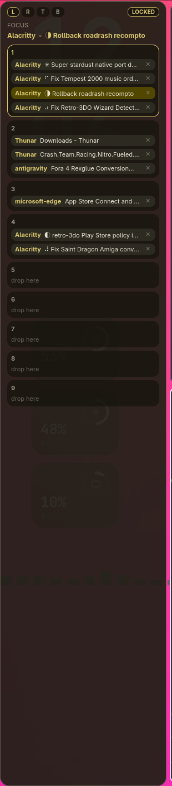

# hypr-windows

An on-screen window map and dock for **Hyprland 0.57**, plus the bar button
that opens it.

Every open window, grouped by the workspace it sits on. Click a window to go
to it, drag it onto another workspace to move it, press its **✕** to close it,
and the top line always names the window that currently has focus.

It docks to any edge, either locked open — reserving its strip so tiled
windows sit beside it — or popping in when the pointer touches the edge.



## Screenshots

Docked along the top instead, with the workspaces running across:


The bar button it replaces four workspace buttons with — click to open the
dock, scroll to change workspace:


## Why

Hyprland hides a lot of state: windows parked on another workspace, windows in
a special workspace (the usual "show desktop" minimise), and nothing on screen
says what has focus. This puts all of it in one place you can act on.

## Requirements

- **Hyprland 0.57 or newer.** It drives the compositor through the Lua
  dispatcher API that 0.57 introduced, so it will not work on 0.4x.
- `gtk4`, `gtk4-layer-shell`, `python-gobject`, and Python 3.9+.

```sh
# Arch
sudo pacman -S gtk4 gtk4-layer-shell python-gobject

# Fedora
sudo dnf install gtk4 gtk4-layer-shell python3-gobject

# Debian/Ubuntu (gtk4-layer-shell may need a backport or a build)
sudo apt install libgtk-4-1 libgtk4-layer-shell0 python3-gi
```

## Install

```sh
git clone https://github.com/CrownParkComputing/hypr-windows
cd hypr-windows
./install.sh            # symlinks bin/* into ~/.local/bin
hypr-windows            # start it (run again to toggle)
```

To start it with your session, use a systemd user unit:

```ini
# ~/.config/systemd/user/hypr-windows.service
[Unit]
Description=hypr-windows dock
PartOf=graphical-session.target
After=graphical-session.target

[Service]
ExecStart=%h/.local/bin/hypr-windows --no-toggle
Restart=on-failure

[Install]
WantedBy=graphical-session.target
```

```sh
systemctl --user enable --now hypr-windows
```

**Do not launch it straight from `hl.on("hyprland.start", ...)`.** That
handler runs about 0.1s into the compositor's boot, but
`$XDG_RUNTIME_DIR/wayland-N` only appears around 3s in, so every Wayland
client started there dies instantly with "cannot connect to display" — which
looks random, because non-Wayland commands in the same handler survive. If you
want it in the config anyway, wait for the socket first:

```lua
hl.on("hyprland.start", function()
    hl.dispatch(hl.dsp.exec_cmd(
        "bash -c 'until [ -S \"$XDG_RUNTIME_DIR/$WAYLAND_DISPLAY\" ]; "
        .. "do sleep 0.2; done; exec hypr-windows --no-toggle'"))
end)
```

To put it on the bar in place of waybar's workspace buttons, see
[`waybar/README.md`](waybar/README.md).

## Using it

| Action | What it does |
| --- | --- |
| Click a window chip | Switches to that window's workspace **and** focuses it |
| Drag a chip onto a workspace | Moves that window there |
| Click a chip's ✕ | Closes that window |
| `L` `R` `T` `B` | Moves the dock to that edge |
| `DRV` | Shows or hides the disks and sticks section |
| `DEV` | Shows or hides the printers and scanners section |
| `LOCKED` / `POP-IN` | Locks the dock open, or lets it slide away |
| Click a section heading | Folds **DRIVES** or **DEVICES** away, and remembers |

### The tray along the bottom

The row under the sections is what a status bar used to carry, so a bar is no
longer needed for it: a start button (`rofi -show drun`), sound, network,
bluetooth, notifications, a lock button and the clock. Sound scrolls to change
the volume and right-clicks to mute; notifications right-click into do not
disturb. Each icon dims when the thing behind it is off, and the clock's
tooltip is the date.

### Ejecting, and putting a disk image back

**eject** unmounts everything on a drive and powers it down; on a loop device
the same button says **detach**. A drive that has been ejected keeps saying
*ejected - safe to unplug* until it is physically unplugged, rather than
offering to eject it again - a refresh that started before the eject used to
land afterwards and undo that. A detached disk image stays listed with a
**re-attach** button, which is the one eject that can be undone: a powered-off
USB drive has to be pulled out and plugged back in, because nothing in a user
session can re-energise a port. The ejected drives are remembered across
restarts, so `DRV` and `DEV` - which restart the dock to settle the layout -
do not lose the re-attach button.

### A colour per desktop

Each workspace number is a badge in its own colour, and that colour carries
to the section's border when it is the active one and to the window chips
inside it. The ring is not a fixed palette: it starts at the hue of
`$primary` in `~/.config/hypr/colors.conf` and walks round the wheel from
there, so workspace 1 always matches the rest of the dock and a re-themed
wallpaper re-colours all nine together. Saturation and value are floored,
because a palette pulled from a washed-out wallpaper would otherwise give
nine shades of the same grey. The walk takes two steps at a time, so two
desktops next to each other are eighty degrees apart rather than forty -
forty is close enough at the yellow-green end of the wheel that two
neighbours came out as twins. Set `"ws_colors": false` for the old look.

### Drives

Every disk you can mount, grouped by the thing you plugged in: filesystem
and size, how full it is, where it is mounted, and buttons to **open**,
**mount**/**unmount** and **eject** it. Removing a drive or plugging one in
redraws the section straight away — it reads the udev stream rather than
polling.

The heading's **plugged in** / **all** button switches between what is
removable or mounted under `/mnt` and `/run/media` (the default, and the
only thing worth keeping in a 300px strip) and every disk in the machine.

What the buttons can do is not a matter of taste. polkit lets an active
local session mount and unmount anything udisks does **not** flag as part of
the system, and refuses the rest unless an authentication agent is running
to ask for a password; a mount point that belongs to the running system —
`/`, `/home`, `/boot` and the rest — gets no unmount button at all, because
pulling one of those out from under a live session is not a thing a button
should make easy.

### Printers and scanners

With `DEV` on, the end of the list holds every CUPS destination and SANE
scanner: what CUPS reports (idle, printing, stopped, not accepting), whether
the device **actually answers** — a queue says `idle` for a printer that is
asleep or on a network you have left — how many jobs are waiting, and buttons
for a test page, clearing the queue and its CUPS page. Click a scanner to scan
to `~/Scans`.

The probes are slow (about 3s for a sleeping printer to refuse a connection,
7s if mDNS has to fail first, 10s for `scanimage -L` to find nothing), so they
run on worker threads: the queue every 15s, reachability every 90s, scanners
every 10 minutes, and all three at once from the section's **scan** button.

Settings live in `~/.config/hypr-windows/config.json` and are written whenever
you change them from the dock:

```json
{
  "position": "left",      // left | right | top | bottom
  "locked": true,          // true: a dock that reserves its strip
                           // false: slides off the edge, pops in on touch
  "width": 300,            // thickness of a left/right dock
  "hide_delay_ms": 600,    // grace period before it slides away again
  "trigger_px": 4,         // sliver left on screen to touch when slid out
  "ws_colors": true,       // a colour per desktop, spun off the accent
  "drives": true,          // disks and sticks you can mount from the dock
  "drives_fixed": false,   // true also lists the machine's own disks
  "drives_seconds": 30,    // safety-net re-read; hotplug arrives by udev
  "drives_open": true,     // false folds the section to its heading
  "devices": true,         // printers and scanners at the end of the list
  "devices_open": true,    // the same for the printers and scanners
  "device_seconds": 15,    // re-read the local CUPS queue
  "probe_seconds": 90,     // re-test whether printers answer
  "scanner_seconds": 600   // re-enumerate SANE scanners
}
```

Flags override the stored settings for one run; add `--save` to keep them:

```sh
hypr-windows --right --save      # dock on the right from now on
hypr-windows --pop-in            # just this once, slide away when unused
hypr-windows --width 360 --save
```

`SIGUSR1` slides a pop-in dock in or out, so a keybind can reach it:

```lua
hl.bind("SUPER + W", hl.dsp.exec_cmd("pkill -USR1 -f hypr-windows"))
```

Running `hypr-windows` again quits a locked dock, and slides a pop-in one
in or out — so one bar button or keybind does the right thing in both modes.
Only one copy can ever run: a second launch acts on the first instead of
starting beside it.

## Notes for anyone hacking on it

Three things here cost real time to find:

- **Hyprland 0.57's dispatchers are Lua, and only honour a window *object*.**
  `hyprctl dispatch "movetoworkspace 1,address:0x..."` is parsed as Lua and
  dies; worse, `hl.dsp.window.close("address:0x...")` returns `ok` and closes
  **whatever has focus**. Every action here loops over `hl.get_windows()` and
  matches `w.address`, then passes the object: `hl.dsp.window.move({ workspace
  = 1, window = w })`. Targeting by object was checked for close by killing an
  unfocused throwaway while a second throwaway held focus — the right one died.
- **gtk4-layer-shell must be loaded before libwayland-client**, which a script
  cannot arrange at link time. Without it the window silently comes up as an
  ordinary toplevel. `hypr-windows` re-execs itself once with
  `LD_PRELOAD=/usr/lib/libgtk4-layer-shell.so`; the `liblayer-shell-preload.so`
  in the same package does *not* fix it.
- **A PID file is not enough to keep one instance.** GTK takes about a second
  to come up, so two clicks inside that window both find no PID file and both
  start — two docks, each reserving a strip. The singleton is a `flock` taken
  before the GTK import, so the loser exits immediately; the PID file is only
  there to carry the running instance's mode to whoever signals it.
- **A hair-thin trigger window would not map** beside a hidden dock, and an
  unmapped dock cannot catch a pointer. Pop-in therefore keeps one surface
  mapped and slides it off the edge with a negative margin, leaving a few
  pixels to touch.

- **`HintSystem` is the whole story for a mount button.** udisks sets it for
  anything that looks like part of the installed system — a disk that is not
  removable, a volume named in `fstab` — and polkit's default rules only let
  an active local session mount and unmount devices *without* it. So it is
  not decoration: it is the difference between a button that works and one
  that returns `NotAuthorized` on a desktop with no polkit agent running.
- **A pinned section still has to fit on the screen.** Drives, a printer and
  a scanner together are taller than the strip, and the window list above
  can only give up so much: whatever lands past the bottom edge is not
  merely ugly, it is unreachable. The bottom of the dock is its own
  scroller, capped at 55% of the monitor, and either section folds away.

The dock sets `KeyboardMode.NONE`: with keyboard focus it would become the
focused window and the focus line would only ever name itself. It sits on
layer `TOP`, the same as a bar, so a fullscreen window and anything on the
`OVERLAY` layer still draw above it.

## Licence

MIT. See [LICENSE](LICENSE).
